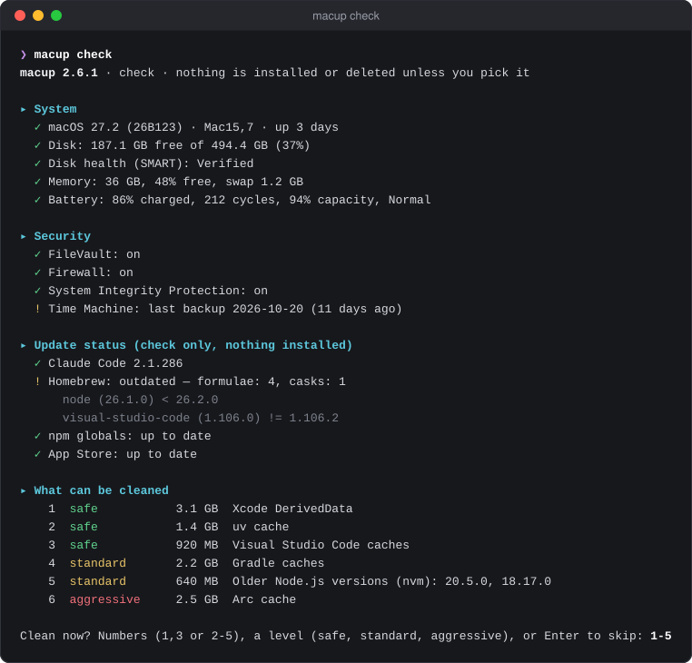
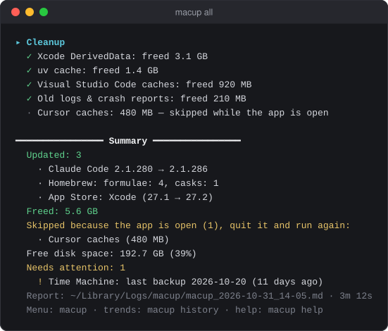
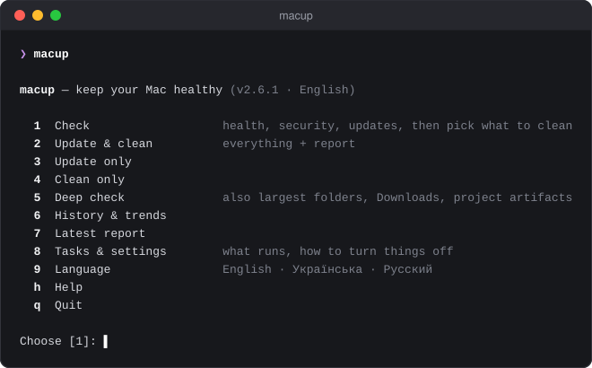

# macup

[](https://github.com/VitaliiDeveloper/macup/actions/workflows/ci.yml)

One command to update, clean and check a developer's Mac.



## Why

A developer's Mac has tools from many package managers, and each one updates with its own command.
Caches from Xcode, simulators, package managers and Electron apps keep growing.
macup updates all of them, deletes only caches that rebuild themselves, and checks the system's health and security in one run.

## Features

- **Updates in one go:** Homebrew, App Store apps (with [`mas`](https://github.com/mas-cli/mas)), Claude Code and its plugins, global npm packages, agent skills in `~/.agents`, pipx, uv tools, rustup, Oh My Zsh, GitHub CLI extensions.
- **macOS updates are reported, never installed.**
- **Cleanup in three levels:** `safe` (rebuilds itself, the default), `standard` (downloaded again), `aggressive` (browser caches; apps may sign you out).
- **Check first, pick later:** `macup check` changes nothing. It lists what can be cleaned, with sizes, and lets you pick.
- **Health and security checks:** disk space and SMART, memory, CPU, battery, FileVault, Firewall, SIP, Gatekeeper, Time Machine, launch agents, Claude Code MCP servers, `brew doctor`, commands that cannot start.
- **Reports and trends:** every run saves a Markdown report. `macup history` shows free space, swap and battery across runs.
- **Interface in English, Ukrainian and Russian.**
- **No dependencies:** a single Bash file that runs on the bash 3.2 that ships with macOS.
- **Tools you don't have are skipped.**

<details>
<summary>What each level cleans</summary>

- 🟢 **safe:** Xcode DerivedData, SwiftUI previews, old DeviceSupport, old device logs, simulator caches, unavailable simulators (also Xcode's test clones); SwiftPM, CocoaPods, Carthage, Homebrew, npm, pnpm, Yarn, pip, uv and Go caches; caches of Electron apps (VS Code, Cursor, Claude, Slack, Discord and others, found by folder layout); Codex leftovers; logs older than 30 days; Quick Look cache.
- 🟡 **standard:** Gradle, Android Studio, Maven; Docker build cache and dangling images; old Playwright/Puppeteer browsers; older patch versions in nvm, rbenv, pyenv, mise and asdf.
- 🔴 **aggressive:** browser caches (Chrome, Arc, Edge, Brave, Firefox, Opera, Vivaldi and other Chromium or Firefox-based browsers). Profiles, passwords and history are never touched.
- **Only when you pick them** (or turn them on with `enable`): simulator runtimes, erasing a simulator, simulators unused for 30 days, other big folders in `~/Library/Caches`, stale `node_modules`, the Trash.
- **Measured, never deleted:** Xcode Archives, simulator devices, Flutter pub-cache, Codex chat history, AI models, Android SDK and emulators; render caches of Final Cut Pro, Premiere/After Effects, DaVinci Resolve, Lightroom Classic and Camera Raw (with the app's own menu item to clear them).

Run `macup tasks` for the full list with task ids.

</details>

### Safety

- **Nothing changes without a command.** Only `all`, `update`, `clean`, the menu, or your pick after a check change anything.
- **`macup check` installs and deletes nothing.** It does go online: it refreshes Homebrew's package list, asks npm, the App Store, Apple and GitHub for versions, and briefly starts your MCP servers to test them.
- **`clean` and `all` stop at `safe`** unless you set `--level` or `clean_level`.
- **Only listed cache folders.** Settings, chat history, keys, `gradle.properties`, Maven's `settings.xml`, browser profiles and pending app updates are never touched. Symlinks are never followed.
- **Pinned versions stay.** Versions named in `.nvmrc`, `.tool-versions`, `.python-version`, virtualenvs and similar files are kept.
- **Apps that are open are skipped.** The summary lists them.
- **Aggressive and opt-in picks ask for a yes.**
- **No sudo, with one exception:** App Store updates need your Mac password (`mas` requires it), and macup asks for it before installing them. A cask's own installer may also ask.
- **Fixes are printed, never run.** For example, `brew link --overwrite node` for a command whose interpreter is gone.

## Requirements

- macOS. The installer refuses other systems. <!-- TODO: oldest macOS version you support/tested -->
- `/bin/bash` 3.2 and `curl`. Both ship with macOS.
- Optional: `python3`, from the Xcode Command Line Tools. Some tasks use it to read JSON: npm globals, agent skills, Claude Code plugins, simulators, the commands check, and finding app caches by folder layout. Without it, those tasks are skipped.
- Optional: the tools macup updates (Homebrew, `mas`, Claude Code, npm, …). Missing ones are skipped.

## Installation

**Installer (recommended):**

```bash
curl -fsSL https://raw.githubusercontent.com/VitaliiDeveloper/macup/main/install.sh | bash
```

It asks for a language and your project folders, offers to install `mas`, then offers a first check. What it changes:

- installs `~/.local/bin/macup` and removes older copies from `/usr/local/bin`, `/opt/homebrew/bin` and `~/.npm-global/bin`
- creates `~/.config/macup/config`, or keeps yours on reinstall
- adds `~/.local/bin` to `PATH` in `~/.zshrc` (and `~/.bash_profile`, if you have one) when it is not there yet

**Unattended:**

```bash
curl -fsSL https://raw.githubusercontent.com/VitaliiDeveloper/macup/main/install.sh | bash -s -- --yes --lang en --projects "~/Code"
```

Installer options: `--lang en|uk|ru`, `--projects "~/Code, ~/Work"`, `--prefix DIR`, `--yes`.

**Homebrew:**

```bash
brew install vitaliideveloper/macup/macup
```

There are no installer questions here. The language follows macOS. Use `macup lang` to change it and `macup config` to set your project folders.

**From source:**

```bash
git clone https://github.com/VitaliiDeveloper/macup.git
```

```bash
cd macup && ./install.sh
```

**Update or remove:**

```bash
macup self-update
```

```bash
macup uninstall
```

`self-update` installs the latest version from GitHub. For a Homebrew install it tells you to run `brew upgrade macup`.
`uninstall` lists everything it will remove and asks once (`--yes` skips the question): the script, settings, history, reports and the installer's `PATH` line. It keeps the `PATH` line if other programs live in that folder. For a Homebrew install it runs `brew uninstall macup`.

## Usage

Start with `macup check`. It lists what can be cleaned, then lets you pick (the screenshot at the top).

Every run ends with a summary and saves a report to `~/Library/Logs/macup/`:



Plain `macup` opens a menu:



### Commands

| Command | What it does |
|---|---|
| `macup` | Interactive menu (outside a terminal it only prints help) |
| `macup check` | Check updates, health and security, list what can be cleaned, let you pick (Enter = nothing) |
| `macup all` | Updates + cleanup up to your level + checks |
| `macup update` | Updates + checks |
| `macup clean` | Cleanup + checks |
| `macup last` | Print the latest report |
| `macup history` | Trends across runs: free space, swap, battery, freed space |
| `macup reports` | Open the reports folder in Finder |
| `macup tasks` | Every task id and whether it is on |
| `macup config` | Create or open the config file |
| `macup lang [en\|uk\|ru]` | Change the interface language |
| `macup self-update` | Install the latest macup from GitHub |
| `macup uninstall` | Remove macup and everything it made |
| `macup help` · `macup version` | Help · version |

### Options

| Option | What it does |
|---|---|
| `--level safe\|standard\|aggressive` | What `clean` and `all` may remove (default: `safe`) |
| `--deep` | Also list the largest folders, old and big files in Downloads, project build artifacts. On its own (`macup --deep`) it is a deep check |
| `--skip id,…` | Skip tasks for this run. Groups work: `'clean.*'` |
| `--only id,…` | Run only these tasks |
| `--lang en\|uk\|ru` | Language for this run |
| `--no-color` | Plain output |
| `--yes` | `uninstall` without the question |

### Examples

```bash
macup check                         # see what's up; nothing changes unless you pick
macup all                           # update everything, clean the safe level
macup clean --level standard        # also Gradle, Maven, Docker, old Node/Ruby/Python patches
macup update --skip update.mas      # updates without the App Store
macup check --only check.security   # only the security checks
macup check --deep                  # find what fills the disk
macup all --no-color                # from a script: plain `macup` only prints help there
```

Quote task groups in zsh: `--skip 'clean.*'`.

## Configuration

`macup config` opens `~/.config/macup/config` in `$VISUAL` or `$EDITOR` (default: `nano`). Defaults:

```ini
language = en                 # en, uk, ru (first run: your macOS language)
skip =                        # tasks to never run; groups work: update.*, clean.*, check.*
enable =                      # opt-in tasks, e.g. clean.stale_node_modules, clean.trash
clean_level = safe            # what clean/all may remove: safe, standard, aggressive
device_support_days = 90      # delete DeviceSupport folders older than this
simulator_days = 30           # offer simulators unused for this long
stale_project_days = 90       # a project is stale after this many days without changes
project_dirs = ~/Developer, ~/Projects, ~/Code, ~/dev, ~/src, ~/repos, ~/work
keep_reports_days = 60        # delete macup reports older than this
```

`project_dirs` is used by `--deep`, by stale `node_modules`, and to find version pins.

Environment variables: `MACUP_LANG` (language), `NO_COLOR` (plain output), `XDG_CONFIG_HOME` (config location).

| Path | Contents |
|---|---|
| `~/.local/bin/macup` | The script |
| `~/.config/macup/config` | Settings |
| `~/Library/Logs/macup/` | Reports (`.md`) and command logs (`.log`) |
| `~/Library/Application Support/macup/history.csv` | Run history for `macup history` |

## Tech stack and architecture

- **Bash**, compatible with the stock macOS bash 3.2. Small embedded Python 3 snippets read JSON.
- **Single-file build:** the source lives in `src/*.sh`. `build.sh` joins the parts in a fixed order and embeds the translations from `src/i18n/translations.json`. The result is the one `macup` file users install.
- **Task registry:** every step has an id (`check.*`, `update.*`, `clean.*`) in one table in `src/core.sh`. `--skip`, `--only`, `skip` and `enable` all use these ids.
- **Cleaners as data:** tables at the top of `src/cleaners.sh` (`CACHE_DIRS`, `TOOL_CACHES`, `ELECTRON_APPS`, `BROWSERS`). A new cache is usually one line.
- **Two-phase cleanup:** cleaners first register candidates with a size and level, then the chosen ones run. Every path is checked against an allow-list again right before it is deleted.
- **Tests:** `tests/run.sh` runs macup against throwaway fake home folders, with fake `pgrep`, `lsof`, `xcrun` and `mas`. It checks that each level deletes exactly the expected files and that protected files survive.
- **CI (GitHub Actions):** ShellCheck on Ubuntu; a bash 3.2 syntax check, the tests, an install and smoke runs on `macos-latest`.

Development:

```bash
./build.sh
```

```bash
tests/run.sh
```

Edit `src/`, run `./build.sh` to rebuild `macup`, then run `tests/run.sh` on macOS. `./build.sh --check` fails if `macup` is out of date. Release notes are in [CHANGELOG.md](CHANGELOG.md).

## License

[MIT](LICENSE)

## Author

**Vitalii Lavreniuk** · [GitHub](https://github.com/VitaliiDeveloper) · [LinkedIn](https://www.linkedin.com/in/vitalii-lavreniuk)
